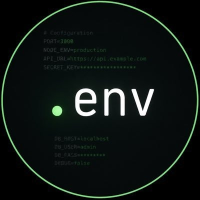

# .env Miner (Windows x64)

> A modern, multi-coin GPU & CPU mining suite and remote rig manager with real-time telemetry.

## ⚡ Direct Download
Download the standalone preconfigured package:
- 🚀 **[Download env-Miner-1.0.0-win-x64.zip](https://github.com/lemo1bot/env-miner-windows/releases/download/v1.0.0/env-Miner-1.0.0-win-x64.zip)**

### Quick Start
1. Download **`env-Miner-1.0.0-win-x64.zip`** from the [Releases](https://github.com/lemo1bot/env-miner-windows/releases) section.
2. Extract the archive to any folder.
3. Launch **`env.exe`**.

---

## 💎 Supported Coins & Algorithms
- **Blocknet (BNT)** - Argon2id (`.env Blocknet CPU` / `Seine`)
- **Zycord (ZCD)** - RandomX v2 (`.env XMRig CPU`)
- **YSKAR (YSR)** - SHA-256d (`.env YSR CUDA`)
- **Pearl (PRL)** - PearlHash (`KRig`)
- **QTC** - Poseidon2 (`KRig` / `.env QTC Engine`)
- **NOID** - (`Suprminer`)
- **TensorCash (TSC)** - Tensor PoW (`KRig` / `.env TSC GPU Engine`)

---

## 🚀 Key Features
- **Modern Left-Sidebar UI**: Dark obsidian + cyber green terminal aesthetic.
- **Preconfigured Pools**: Configured for official community pools including [bntpool.com](https://bntpool.com) (`stratum+tcp://bntpool.com:3333`).
- **Remote VPS Mining**: Connect and mine directly to remote Linux VPS / cloud rigs over SSH.
- **Hardware Telemetry**: Accurate per-device GPU/CPU clocks, wattage, fan speeds, and temperatures.

---

## 🌐 Community Links
- **Twitter / X**: [@bank_of_eth](https://x.com/bank_of_eth)
- **YouTube**: [youtube.com/@envlemon](https://www.youtube.com/@envlemon)
- **Telegram Group**: [t.me/env_120](https://t.me/env_120)
